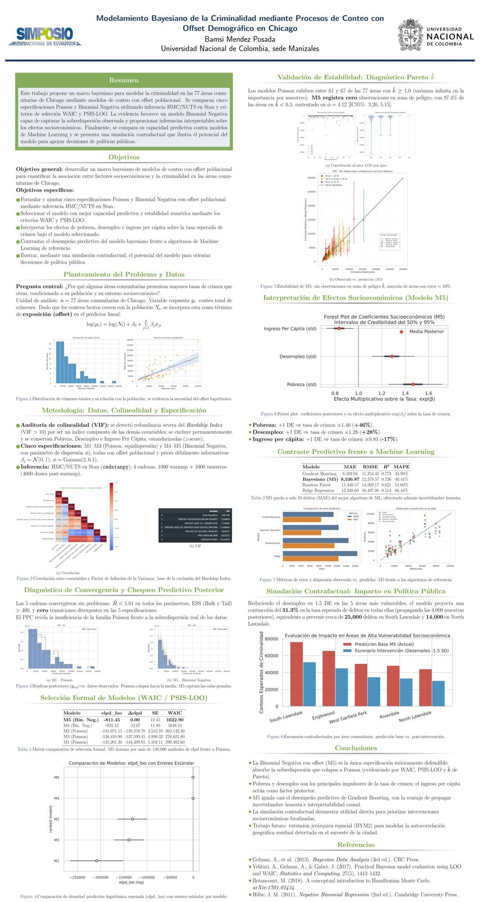

# Criminalidad en Chicago: modelos bayesianos de conteo

**Bamsi Mendez Posada · Universidad Nacional de Colombia, sede Manizales**  
Proyecto presentado en el XXXV Simposio Internacional de Estadística, 2026.

Análisis de la asociación entre condiciones socioeconómicas y conteos de delitos
en las **77 áreas comunitarias de Chicago**, con población como exposición.
Combina modelos Poisson y Binomial Negativa, inferencia HMC/NUTS en Stan,
diagnósticos posteriores y contraste exploratorio con aprendizaje automático.

[Ver póster](poster/Poster_Chicago_SIE_2026.pdf) ·
[Leer informe detallado](docs/Informe_Chicago.pdf) ·
[Explorar análisis](notebooks/02_bayesian_analysis.ipynb) ·
[Notas sobre los resultados](docs/NOTAS_DE_VERSION.md)



## Pregunta y enfoque

¿Cómo se asocian pobreza, desempleo e ingreso per cápita con la tasa esperada de
delitos, condicionando por el tamaño poblacional de cada área comunitaria?

El predictor usa `log(mu_i) = log(N_i) + alpha + X_i beta`. Los datos combinan
registros de delitos, indicadores socioeconómicos y población. Las covariables se
estandarizan; los cinco modelos comparados no contienen efectos espaciales.

| Modelo | Familia | Covariables estandarizadas |
|---|---|---|
| M1 | Poisson | Pobreza, desempleo |
| M2 | Poisson | Pobreza, desempleo, ingreso per cápita |
| M3 | Poisson | Pobreza, sin diploma de secundaria, hacinamiento |
| M4 | Binomial Negativa | Pobreza, desempleo |
| M5 | Binomial Negativa | Pobreza, desempleo, ingreso per cápita |

## Resultados archivados

Las salidas originales favorecen M5: `elpd_loo = -811.45`,
`elpd_waic = -811.28` y ninguna observación con Pareto k >= 0.7.
La comparación exploratoria con ML usa 53 áreas para entrenamiento y 24 para prueba:

| Modelo | MAE | RMSE |
|---|---:|---:|
| Gradient Boosting | 8502.94 | 11254.42 |
| Bayesiano seleccionado | 8536.87 | 12378.57 |
| Random Forest | 11448.57 | 14569.17 |
| Ridge | 12348.60 | 16497.80 |

Estas cifras provienen de las salidas guardadas, no de una nueva ejecución.
El póster y el informe contienen discrepancias numéricas y una sección ilustrativa
basada en simulaciones; consulte las [notas de versión](docs/NOTAS_DE_VERSION.md)
antes de citar efectos, escenarios o tablas. Los escenarios no identifican efectos causales.

## Contenido

| Ruta | Contenido |
|---|---|
| `poster/` | PDF final y vista previa |
| `docs/` | Informe existente, fuente LaTeX, reproducción y notas |
| `notebooks/` | Preparación y análisis principal, sin salidas incrustadas |
| `stan_models/` | Dos modelos Stan en código fuente |
| `data/` | Datos agregados, dos fuentes auxiliares y diccionario |
| `results/` | Ocho figuras seleccionadas y salidas numéricas archivadas |

## Ejecución

Desde la raíz del repositorio, con Python 3.11 o 3.12 recomendado:

```powershell
python -m venv .venv
.\.venv\Scripts\python.exe -m pip install -r requirements.txt
.\.venv\Scripts\python.exe -c "import cmdstanpy; cmdstanpy.install_cmdstan()"
.\.venv\Scripts\python.exe -m jupyterlab
```

Abra `notebooks/02_bayesian_analysis.ipynb` y ejecute en orden. CmdStan requiere
un compilador C++ configurado; véase [reproducción](docs/REPRODUCIBILITY.md).
El CSV de delitos completo no es necesario para ejecutar el análisis a partir
de `data/processed/final_data_2.0.csv` (77 filas y 29 columnas).

## Alcance

Estudio ecológico observacional, con conteos acumulados desde 2015 y covariables
de distintas ventanas temporales. Las tasas no son tasas anuales. La validación
predictiva es exploratoria; no hay modelo espacial ni identificación causal.
La preparación del repositorio verificó estructura, sintaxis y coherencia básica
de los datos, sin repetir MCMC ni reconstruir el agregado desde el CSV ausente.

Los datos proceden del Chicago Data Portal; consulte [su procedencia](data/README.md).
No se asigna una licencia de redistribución al material original o de terceros.
La fuente LaTeX incluida corresponde al informe; no se dispone en este paquete de
una fuente LaTeX que reproduzca el diseño del póster final.
